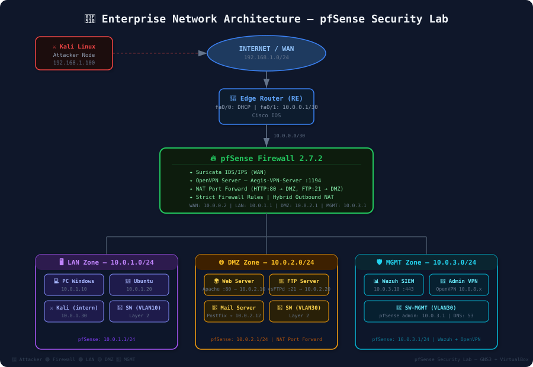

# 🔐 pfSense Security Lab — Enterprise Network Architecture

> A complete enterprise-grade network security lab built with pfSense, GNS3, Suricata IDS/IPS, and OpenVPN.

---

## 📋 Project Overview

This lab simulates a real-world enterprise network with a multi-zone security architecture. It covers firewall configuration, intrusion detection, VPN access, DMZ hosting, and centralized log management — all deployed in a virtualized environment using GNS3 and VirtualBox.

---

## 🏗️ Network Architecture


---

### Zones

| Zone | Subnet | Description |
|------|--------|-------------|
| LAN | 10.0.1.0/24 | Internal workstations (Windows, Ubuntu, Kali) |
| DMZ | 10.0.2.0/24 | Public-facing servers (Web, FTP, Mail) |
| MGMT | 10.0.3.0/24 | Administration (Wazuh SIEM, VPN Admin) |
| WAN | 10.0.0.0/30 | Edge router uplink to internet |

---

## 🧩 Components

### Firewall — pfSense 2.7.2
- Multi-zone segmentation (LAN / DMZ / MGMT / WAN)
- Strict inter-zone firewall rules
- NAT Port Forwarding (HTTP → 10.0.2.10, FTP → 10.0.2.20)
- Hybrid Outbound NAT

### IDS/IPS — Suricata
- Deployed on WAN interface
- Pattern match: AUTO mode
- Real-time threat detection and blocking

### VPN — OpenVPN
- Server name: `Aegis-VPN-Server`
- Port: 1194 (UDP)
- Admin access via MGMT zone
- IP tunnel: 10.0.8.x


### Services Running
| Service | Description | Status |
|---------|-------------|--------|
| dhcrelay | ISC DHCP Relay | ✅ Running |
| dnsmasq | DNS Forwarder | ✅ Running |
| openvpn | Aegis-VPN-Server | ✅ Running |
| suricata | IDS/IPS Daemon | ✅ Running |
| ntpd | NTP Clock Sync | ✅ Running |
| syslogd | System Logger | ✅ Running |

---

## 🔒 Firewall Rules Summary

### WAN Rules
| Protocol | Port | Description |
|----------|------|-------------|
| IPv4 TCP | 80 (HTTP) | NAT to Web Server |
| IPv4 TCP | 21 (FTP) | NAT to FTP Server |
| IPv4 UDP | 1194 (OpenVPN) | VPN Tunnel |

### DMZ Rules
| Action | Source | Destination | Description |
|--------|--------|-------------|-------------|
| ❌ Block | DMZ | 10.0.3.0/24 | DMZ cannot reach Admin |
| ❌ Block | DMZ | 10.0.1.0/24 | DMZ cannot reach LAN |
| ❌ Block | DMZ | Firewall (self) | DMZ cannot attack firewall |
| ✅ Allow | Any | DMZ | Traffic to services |
| ✅ Allow | DMZ | Any | Internet access for updates |

### MGMT Rules
| Protocol | Source | Destination | Description |
|----------|--------|-------------|-------------|
| UDP | 10.0.3.0/24 | 10.0.3.1 port 53 | DNS to pfSense |
| IPv4 * | 10.0.3.0/24 | Any | MGMT to Any |
| TCP | 10.0.3.10 | Firewall port 80-443 | Admin to pfSense |

---

## 🖥️ Lab Topology (GNS3)

**Nodes:**
- `pfSense-1` — Main firewall (pfSense 2.7.2)
- `RE` — Edge Router (Cisco)
- `SW / Switch1 / Switch2` — Layer 2 switches
- `KaliLinux2025` — Attacker simulation
- `Server-WEB` — Apache web server (10.0.2.10)
- `Server-FTP` — vsFTPd server (10.0.2.20)
- `Server-DHCP` — DHCP server
- `PC1–PC5` — Client workstations
- `Admin` — VPN admin station (MGMT zone)

---

## 📁 Repository Structure

```
pfsense-lab/
├── README.md
├── screenshots/        # Lab screenshots and captures
├── configs/            # Configuration files
└── Topologie/          # GNS3 topology files
```

---

## 🚀 Getting Started

### Prerequisites
- [GNS3](https://www.gns3.com/) with VirtualBox integration
- pfSense 2.7.2 ISO
- Kali Linux 2025 image

### Quick Setup
1. Import the GNS3 topology from `/Topologie/`
2. Attach pfSense VM in VirtualBox
3. Configure interfaces as per the network architecture above
4. Access pfSense dashboard at `https://10.0.3.1`

---

## 🛠️ Tools & Technologies


---

## 📌 Key Concepts Covered

- Multi-zone network segmentation (LAN / DMZ / MGMT)
- Stateful firewall rule design
- NAT and port forwarding configuration
- Intrusion Detection & Prevention (IDS/IPS) with Suricata
- VPN tunnel setup with OpenVPN
- Centralized log management with Wazuh SIEM
- Attacker simulation with Kali Linux
- Network topology design with GNS3

---

## 👤 Author

**Yasser** — Network & Security Engineer  
🔗 [GitHub](https://github.com/Yasser-02G)

---

> ⚠️ **Disclaimer:** This lab is for educational purposes only. All configurations are simulated in an isolated virtual environment.
